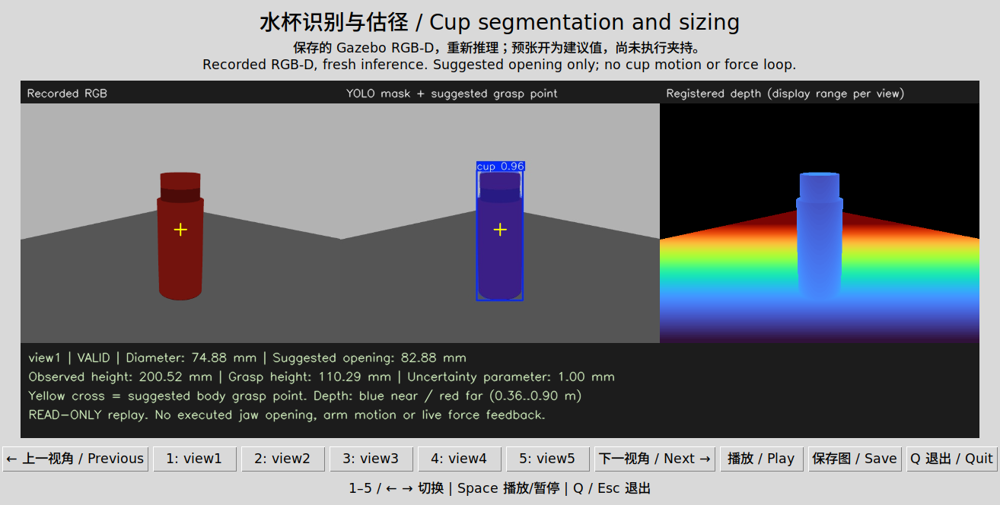

# Cup training and RGB-D sizing: reproduction guide

This release adds an independent `simulation_cup/` workspace. The repository's previous `simulation/` and `brain_robot_arm/` remain intact. Local development used `simulation/`; the commands below use the published directory.

Implemented: trained cup instance segmentation, mask-derived RGB-D sizing, a read-only ROS perception node, complete dataset/training archives, and offline opening/contact-force policies. **Force-controlled cup pick-and-place has not yet been integrated or accepted.** The existing ball/cylinder entry points remain known-specimen position-preload demonstrations. See the [stage report](../stage4_cup_training_report.en.md).

## 1. Environment and checkout

Verified environment: Ubuntu 22.04.5, ROS 2 Humble, Gazebo Classic 11, Python 3.10. CPU training requires no CUDA or driver changes. Classic plugins cannot be used directly with Fortress/Garden.

```bash
git clone https://github.com/bcwsyn/brain-robot-arm.git
cd brain-robot-arm/simulation_cup
```

Use the [Stage 3 environment guide](../simulation/README.en.md) for ROS/MoveIt/Gazebo prerequisites, substituting `simulation_cup/` for its workspace directory. If Python prerequisites are missing, the reader may install them:

```bash
sudo apt update
sudo apt install python3-pip python3-venv python3-tk
```

No system packages were installed during this development. Leave Conda inactive and do not source the real-robot workspace into this terminal.

## 2. Build and algorithm checks

Exit any previous project simulation using port 11483, then build only this workspace:

```bash
bash scripts/build_simulation.sh
source /opt/ros/humble/setup.bash
source install/setup.bash
export PYTHONNOUSERSITE=1
colcon test --packages-select brain_robot_pick_place
colcon test-result --verbose
```

Expected development result: 69 algorithm cases and 9 CTest targets; colcon reports 78 total, with zero failures/errors/skips. Its total includes test targets and is not a count of independent algorithm scenarios. All seven ROS packages have their own generated build/install/log outputs here.

## 3. Create the private vision environment

The setup script installs into `.venv-yolo/`, without sudo or changing system Python:

```bash
bash scripts/setup_cup_vision_env.sh
export PYTHONNOUSERSITE=1
export YOLO_CONFIG_DIR="$PWD/artifacts/yolo/config"
.venv-yolo/bin/python -s -c 'import torch, numpy, cv2, ultralytics; print(torch.__version__, numpy.__version__, cv2.__version__, ultralytics.__version__)'
```

Main versions: Torch 2.6.0+cpu, NumPy 1.24.4, OpenCV 4.11.0, Ultralytics 8.3.203. The complete observed package list is `validation/cup_vision/python_environment_freeze.txt`. Both `-s` and `PYTHONNOUSERSITE=1` prevent user-site NumPy 2 from interfering with Humble libraries.

Initial package installation needs internet access. Model files are already included:

| File | Purpose |
| --- | --- |
| `models/cup_yolov8n_seg_v2.pt` | Recommended frozen single-class model, cup ID 0 |
| `models/yolov8n_seg_coco.pt` | Original official COCO model, cup ID 41; initialization/baseline |
| `models/cup_model_provenance.json` | Sources, checksum, scope and license references |

Tools look up the class by name. Do not pass COCO ID 41 to the single-class model.

## 4. Visual replay and model checks

### 4.1 Open the interactive cup viewer

After creating the private environment in section 3, run from an Ubuntu desktop terminal:

```bash
bash scripts/run_cup_visual_replay.sh
```

A ROS build is unnecessary for this entry. It **reruns YOLO segmentation and RGB-D sizing** on the five included captures using the included v2 model, then opens a window. It does not simply show old prediction images. Startup normally takes a few seconds; the terminal prints the new session directory.

Left to right: recorded RGB, segmentation overlay, registered depth with a per-view display range. The yellow cross marks the suggested body grasp point. Numerical results show estimated diameter, suggested opening, observed height, grasp height and uncertainty parameter. Expect one cup in each view, diameter approximately 74.86–74.88 mm, suggested opening 82.86–82.88 mm and observed height approximately 200 mm.

| Control (focus the viewer window) | Action |
| --- | --- |
| `1`–`5` or view buttons | Select a camera view |
| Left / Right arrows | Previous / next view |
| Space or Play/Pause | Cycle every two seconds or pause |
| Save | Save the current three-panel image and numbers |
| `Q`, Escape, Quit, or window close | Exit and save the viewing receipt |

Each run creates a new `log/cup_visual_replay.XXXXXX/`. `inference/` contains overlays, masks and `results.json`; `evaluation.log` contains inference output; `screenshots/` contains images saved with the button; `viewer_session.json` records visited views and exit. Previous sessions are preserved.

To start in autoplay mode:

```bash
bash scripts/run_cup_visual_replay.sh --autoplay
```

**This is a visual replay of recorded frames. It does not open a live camera, execute the suggested jaw opening, move an arm or display measured force feedback.** Integrated cup pick-and-place remains pending. Section 9 provides the existing ball/cylinder motion demonstrations.



### 4.2 Headless model and geometry check

This reads five saved RGB-D views. It starts no Gazebo server, robot or motion. **Every output directory must be new; use a different name for repeated runs.**

```bash
PYTHONNOUSERSITE=1 .venv-yolo/bin/python -s scripts/evaluate_cup_holdout.py \
  --capture validation/cup_vision/stepped_cup_probe \
  --model models/cup_yolov8n_seg_v2.pt \
  --output log/my-cup-model-check
```

Expect `successful_sizing: 5`. Outputs contain overlays, predicted masks, diameter/height/opening estimates and JSON. Reference results: one cup per image, IoU approximately 0.961–0.977, maximum body-diameter error approximately 0.137 mm in ideal simulated depth. This is not real-camera accuracy.

For segmentation predictions alone:

```bash
PYTHONNOUSERSITE=1 .venv-yolo/bin/python -s scripts/evaluate_cup_model.py \
  --images validation/cup_vision/stepped_cup_probe/images \
  --model models/cup_yolov8n_seg_v2.pt \
  --output log/my-cup-segmentation-check
```

Predictions alone do not establish precision/recall or graspability.

## 5. Actual ROS-node replay

This starts the read-only perception node and supplies recorded RGB-D and calibrated TF. It does not start a robot. Domain 84 is separate from the legacy physical session's domain 83. In a fresh terminal, enter this workspace:

```bash
source /opt/ros/humble/setup.bash
source install/setup.bash
export PYTHONNOUSERSITE=1
export ROS_DOMAIN_ID=84
export ROS_LOCALHOST_ONLY=1
export RMW_IMPLEMENTATION=rmw_fastrtps_cpp
export FASTRTPS_DEFAULT_PROFILES_FILE="$PWD/validation/fastdds_local_udp.xml"
export RMW_FASTRTPS_PUBLICATION_MODE=ASYNCHRONOUS
/usr/bin/python3 -s scripts/verify_cup_ros_replay.py \
  --capture validation/cup_vision/stepped_cup_probe \
  --model models/cup_yolov8n_seg_v2.pt \
  --output log/my-cup-ros-check
```

Expect five positive views, a blank-image rejection and a stale-image rejection to pass, with exit code 0. Results and node logs are saved in the output directory. The script terminates only the node it started.

| Topic | Contract |
| --- | --- |
| `/brain_robot_vision/cup_grasp_point` | `PointStamped`, image timestamp, world frame |
| `/brain_robot_vision/grasp_width` | `Vector3Stamped`: x diameter m, y uncertainty parameter m, z suggested opening m |
| `/brain_robot_vision/cup_target_valid` | `Bool`, observation validity |
| `/brain_robot_vision/cup_diagnostic` | JSON `String`, validity/rejection reason and geometry |
| `/brain_robot_vision/cup_debug_image` | Segmentation overlay |

The prototype rejects multiple cup instances, stale images, missing image-time TF, unusable depth, unobservable external walls and excessive required opening. Default inputs are the legacy simulated wrist RGB-D topics. Its separate outputs are not connected to the motion executor.

Inputs use reliable QoS, matching current Gazebo/replay publishers. Real-camera QoS/calibration requires separate adaptation. Replay waits for actual image subscription endpoints and associates diagnostics by frame name, so results from the preceding view do not qualify the next view.

## 6. Capture fresh Gazebo images

This starts a dedicated Gazebo server, table, hollow stepped cup and five fixed RGB-D cameras. No arm is loaded. Depth rendering needs an available graphics environment even without a GUI. Continue with the environment above:

```bash
export GAZEBO_MASTER_URI=http://127.0.0.1:11484
/usr/bin/python3 -s scripts/probe_cup_rgbd.py --output log/my-fresh-cup-probe
```

Expect five captures followed by automatic cleanup. RGB images are under `images/`; NPZ files contain depth and intrinsics; `capture.json` contains camera poses and fixture checks. The default geometry follows the user specimen. Wall thickness 2 mm and mass 80 g are assumptions.

Historical SDFs record collection-time absolute mesh URIs. Regenerate with the script rather than launching those historical world files after moving the repository.

## 7. Restore every dataset and training revision

Archives are under `validation/cup_vision/archives/`. Parts are at most 45 MiB; the manifest and `SHA256SUMS` contain part/joined checksums.

```bash
/usr/bin/python3 -s scripts/restore_cup_archives.py
```

Default destination: `artifacts/cup_training/`. Bundles: `dataset_v1`, `dataset_v2`, `final_test_v2`, `train_v1`, `train_v2`, `physics_sessions`, and `published_sessions`. Existing bundles are never overwritten. Select bundles with repeated `--bundle`, or choose another destination, for example `--destination log/my-restored-data`.

Saved material includes raw RGB-D, camera calibration/poses, geometry, labels, split manifests, both training revisions, CSV/arguments/curves, validation plots, best/last weights, periodic checkpoints and physical-regression logs. The incorrect v1 annotations/predictions remain available for review.

## 8. Reproduce training

Restore the archives first. The corrected dataset YAML does not require the original collection machine's root path.

```bash
PYTHONNOUSERSITE=1 OMP_NUM_THREADS=6 .venv-yolo/bin/python -s scripts/train_cup_model.py \
  --data artifacts/cup_training/dataset_v2/data.yaml \
  --model artifacts/cup_training/train_v1/weights/best.pt \
  --output log/my-cup-training \
  --epochs 12
```

Original v2 started from v1's best checkpoint. To train from COCO instead, use `models/yolov8n_seg_coco.pt` and a suitable epoch budget; that is a new experiment. Fixed seeds help reproduction but do not guarantee identical results across hardware/software changes.

`final_test_v2` is evaluation-only for a frozen model. Never train or tune on it. The five user-specimen views were used for development diagnostics, so they are not an untouched final test set.

## 9. Legacy motion and contact-force policies

After the build in section 2, run one entry to open Gazebo and RViz and wait for a start command:

```bash
bash scripts/run_ball_physics_sim.sh
```

Alternatively, exit the ball session first, then run:

```bash
bash scripts/run_cylinder_physics_sim.sh
```

**Press keys in the launching terminal; no Enter is needed.** `1/2` selects the placement zone, `S` starts, `R` randomizes/reset after completion, `X` stops, and `Q` exits the whole session. The default stroke is now 100 mm; those specimens still use known-diameter position preload, not adaptive cup force control. The cylinder is not the user's hollow stepped cup.

`adaptive_gripper_policy.py` derives opening from measured diameter, uncertainty and clearance, then adjusts commanded opening from bilateral normal force. Its current 1.2–2.5 N band and 5 N hard threshold are configurable simulation settings. Gazebo convergence for the complete cup task and real force calibration remain pending. SDK effort is torque in N·m and cannot be supplied directly as contact force in N.

## 10. Troubleshooting

| Symptom | Action |
| --- | --- |
| pip missing | Install system `python3-pip`; setup uses venv without ensurepip |
| NumPy 2 / cv_bridge errors | Leave Conda, set `PYTHONNOUSERSITE=1`, retain `-s` |
| Model missing | Use the included `models/cup_yolov8n_seg_v2.pt` |
| Output already exists | Choose a new output directory to preserve prior evidence |
| Viewer cannot open | Use a local desktop terminal with a valid `DISPLAY` and `python3-tk`; section 4.2 works without a display |
| ROS node exits | Inspect `node.log`, private Python dependencies and ROS overlay |
| Gazebo port occupied | Exit the owning simulation; scripts do not kill foreign processes |
| Real cup fails despite synthetic scores | Collect separate real-camera evaluation data; current acceptance is synthetic only |
| Looking for automatic cup grasp | Force-control integration is pending; do not map new topics into the legacy known-specimen executor |

Dependency/model licensing references are in `models/cup_model_provenance.json` and `models/LICENSE-ultralytics.txt`. Robot-source attribution remains in `UPSTREAM_PROVENANCE.md`.
