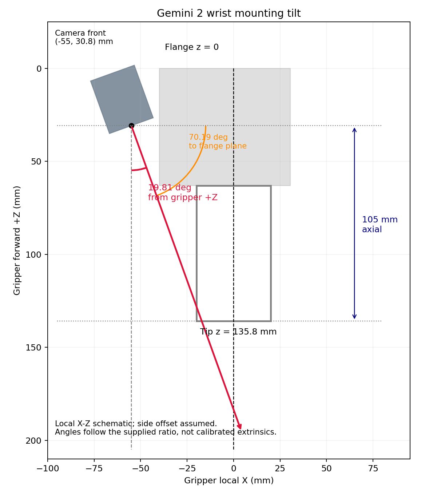

# Stage 5 supplement: wrist-camera tilt correction

Date: 2026-10-14. Scope: `simulation/`; GitHub workspace `simulation_cup_wrist/`. This update corrects the camera angle while retaining its mounting position, cup model, YOLO weights and force-feedback controller.

## Angle and implementation

The supplied displacement ratio gives `atan2(2.45,6.8)=19.813793°`. Line extraction from the [annotated photograph](wrist_camera/tilt_reference.png) gives approximately18.3–18.6° relative to image vertical, consistent in direction. Perspective and hand-drawn annotations prevent a precise 3-D calibration. The manual ratio sets the nominal angle; the photograph establishes its direction/reference.

The camera tilts approximately **19.81° from the gripper forward axis towards its centre**, equivalent to **70.19° to the perpendicular flange plane**. This plane moves with the wrist; it is not a fixed world-horizontal plane.



The shared `gemini2_wrist_camera.xacro` macro exposes `tilt_rad`, defaulting to `atan2(2.45,6.8)`. The mounting joint now uses `rpy=(0,-π/2+tilt_rad,0)`. Housing, collision geometry, inertia and sensor rotate together in both Gazebo and MoveIt. Optical forward in gripper coordinates is `[sin(tilt),0,cos(tilt)]`, towards +X from the camera's assumed x=-55 mm position.

The nominal front/optical reference point remains `(-55,0,30.8) mm`, 105 mm axially behind the finger-tip reference. Side offset, optical centres and hand-measured angle remain uncalibrated assumptions. The fixed observation configuration changes from joint5=0.44 rad to `[-0.27,0,0,0,0.15,0] rad`, preserving the full cup view with collision-checked planning independent of Gazebo cup coordinates.

Every visual input still comes from the one moving wrist RGB-D camera and image-time TF. No external camera or new model training is introduced. The observation packet is locked before close-range force-feedback execution.

## Verification

Expanded Gazebo/MoveIt URDFs agree on tilt, optical direction, mounting point and collision envelope. The 105 mm axial spacing and 150 mm minimum depth remain unchanged. All 96 aggregate core checks pass with zero failures/errors/skips.

The frozen-code 75 mm A/B batch passes 2/2, seed20261015, session `cup-20261014-231434-893953`:

| Metric | A | B |
| --- | --- | --- |
| Estimated diameter | 74.896 mm | 74.889 mm |
| Estimated height | 200.478 mm | 200.426 mm |
| Preopening | 82.896 mm | 82.889 mm |
| Actual peak lift | 144.808 mm | 144.819 mm |
| Hold duration | 3.25 sim s | 3.25 sim s |
| Placement error | 1.510 mm | 1.057 mm |
| Left hold force | 2.702–3.161 N | 2.704–3.176 N |
| Right hold force | 2.795–3.140 N | 2.764–3.171 N |
| Maximum home error | 0.000094 rad | 0.000099 rad |

Both trials verify physical capture, lift, hold, transport, settled release and return. Diagnostics identify `wrist_camera_optical_frame`; unsupported finger detections are rejected geometrically. Object truth remains an independent acceptance input. GUI/release results are recorded separately in `validation/wrist_camera_tilt_20261014/final_validation.json`.

The independent-release GUI trial passes1/1; R returns to observation/recognition and Q exits cleanly. Its model verification and96 core checks pass. Tilt increases foreground finger occlusion, and some finger pixels contaminate the segmentation mask. Depth/geometric filtering still supports sizing of the visible grasp region; complete contours and robust handling of complex occlusion are not established.

Full55/85 mm and fault batches have not been repeated. Earlier untilted/fixed-camera results are not counted here. No physical hardware was connected; this manual mounting estimate does not establish real-scene recognition performance or hand-eye calibration.

## Reproduction and retained data

Follow the [English guide](wrist_camera/README.en.md) or [Chinese guide](wrist_camera/README.zh-CN.md). After pulling, enter `brain-robot-arm/simulation_cup_wrist`, build, configure the private vision environment if needed, then:

```bash
source /opt/ros/humble/setup.bash
source install/setup.bash
export PYTHONNOUSERSITE=1
/usr/bin/python3 -s scripts/verify_wrist_camera_model.py
bash scripts/run_cup_grasp_sim.sh --seed 20261015
```

Wait for observation/recognition ready, then use terminal S/R/Q. Inspect the tilted camera housing in Gazebo/RViz and its moving RGB-D detection view.

Measurements, three pre-update source files, model checks, build/core-test logs, physical/GUI sessions and archive/publication receipts are retained under `validation/wrist_camera_tilt_20261014/`. Earlier data are preserved. The untilted release remains accessible at `cup-wrist-gemini2-v1-20261014`; the tilt update receives its own tag.

The tilt archive verifies927 files individually, occupies3400164 bytes, SHA-256 `b45ffb700ec73d6b197a2e0eb6267a01a107299166555ab01e36a026b82bb7bc`. All217 runtime files match the release.

## GitHub publication

Updated `simulation_cup_wrist/`, code commit `fc0af8bdeae703934d4bd5f53cc3bbd12af65135`, tag `cup-wrist-gemini2-tilt-v2-20261014`. Three remote key files were downloaded and verified byte-for-byte. Four earlier workspace trees and the untilted v1 tag remain intact. See `validation/wrist_camera_tilt_20261014/github_publication.json`.
