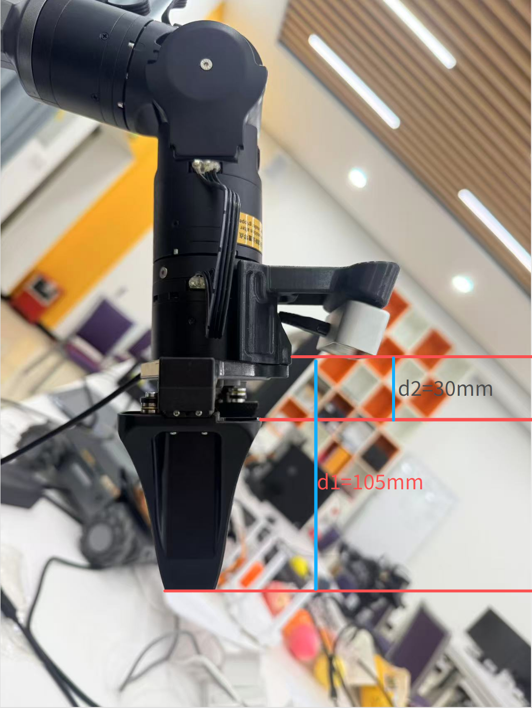
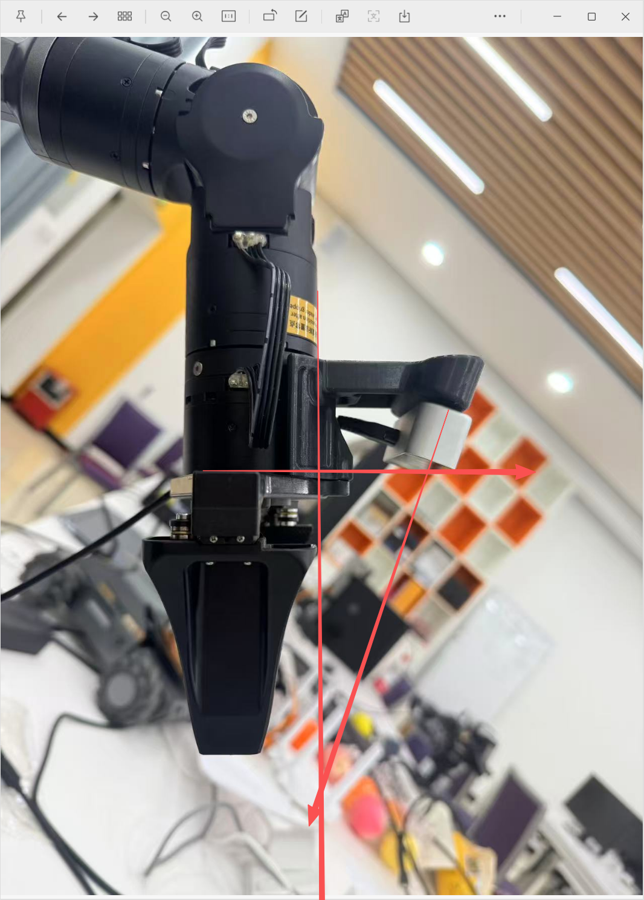
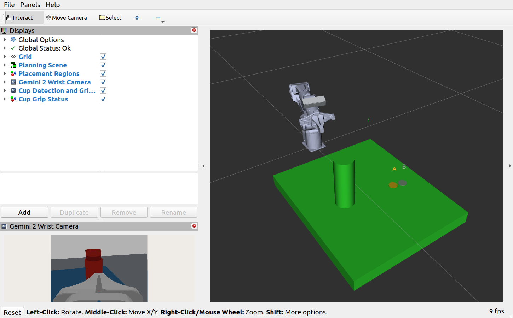
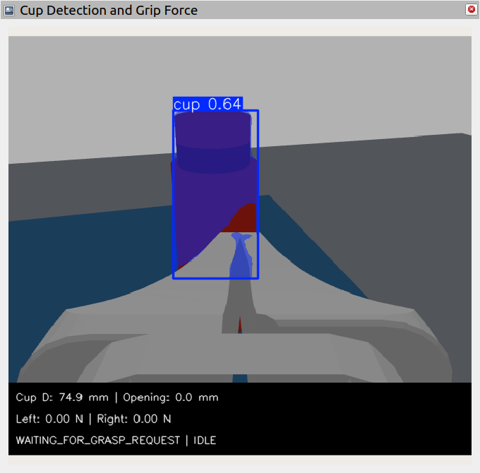

# 单腕部 Gemini 2：安装模型与水杯视觉复现

2026-10-14 倾角更新：相机向夹爪中心偏转约19.81°，与法兰平面约70.19°；见[倾角修正报告](../第五步补充_腕部相机倾角修正与验证.md)。首次未倾斜版本及其数据保留在标签 `cup-wrist-gemini2-v1-20261014`。

本版本只使用随机械臂运动的一台腕部 RGB-D 相机：彩色图 → YOLO 杯子掩膜 → 配准深度 → 图像时刻的机器人 TF → 世界抓取点与外径 → 预张开与仿真力反馈取放。仿真世界不创建固定外部相机。

GitHub 独立工作区为 `simulation_cup_wrist/`。此前固定相机版本 `simulation_cup_grasp/`、训练版本 `simulation_cup/` 和球/圆柱版本 `simulation/` 都保留。请选择一个工作区构建。

## 1. 安装位置及参数来源



照片给出的是沿夹爪方向的近似距离，不是相机中心到指尖的三维直线距离。本版将相机前端名义光学参考点设在 `gripper_base` 法兰坐标的 `z=30.8 mm`，模型指尖位于 `z=135.8 mm`，两者轴向相差 **105 mm**。30.8 mm 对应用户描述的约 30 mm；没有缩短夹爪或修改其 100 mm 行程。

按现有网格，指爪与夹爪本体连接区域约在 `z=59.3–63 mm`，与相机前端相差约 `28.5–32.2 mm`，也对应照片中 `d2≈30 mm` 的根部距离。

相机横向位置 `x=-55 mm、y=0` 沿用仿真假设；倾角采用 `atan2(2.45,6.8)`，约19.81°，朝夹爪中心。参考图的斜线与竖线约18–19°，与水平线约71–72°，手工比值作为模型设定值；照片无法给出精确六自由度外参。此位置是安装近似，不是实机手眼标定结果。外壳前端也是名义光学参考面，实际 RGB/IR 光心要以后用标定确定。

依据 [Orbbec Gemini 2 官方资料](https://www.orbbec.com/wp-content/uploads/2023/04/ORBBEC_Datasheet_Gemini-2-3.pdf)，外壳采用宽 90、高 25、深 30 mm，质量 97 g，深度有效范围 0.15–10 m。仿真采用 640×480 配准 RGB-D，RGB 水平视场约 63°，深度对齐到该 RGB 视场；没有把原生 IR 的 91° 视场直接套到 RGB 图上。它没有模拟主动双目算法、完整畸变或厂商 D2C 实现。

唯一的几何定义为 `src/piper_description/urdf/gemini2_wrist_camera.xacro`，由 Gazebo 和 MoveIt 共同包含；相机外壳也进入碰撞检查。相机前方为光学坐标 `+Z`，在夹爪坐标中方向为 `[sin(tilt),0,cos(tilt)]`。固定安装坐标通过机器人关节反馈生成随手臂变化的 TF；与固定世界水平面的夹角随机械臂运动而变化。




## 2. 环境与构建

已验证环境沿用 Ubuntu 22.04.5、ROS 2 Humble、Gazebo Classic 11、MoveIt 2、系统 Python 3.10 和项目私有 CPU 视觉环境。系统依赖及图形环境参见[仿真环境指南](../simulation/README.zh-CN.md)，视觉依赖参见[训练版本指南](../cup_simulation/README.zh-CN.md)。纯 SSH 且没有图形渲染环境仍不能生成 Gazebo 深度图。

首次获取：

```bash
git clone https://github.com/bcwsyn/brain-robot-arm.git
cd brain-robot-arm/simulation_cup_wrist
```

已有仓库则在根目录执行 `git pull --ff-only`，进入 `simulation_cup_wrist`。本机开发目录则使用 `/home/young1x/robot_projects/piper_robot/simulation`。退出 Conda，使用新的 Ubuntu 终端，不加载其他工作区：

```bash
bash scripts/build_simulation.sh
bash scripts/setup_cup_vision_env.sh
source /opt/ros/humble/setup.bash
source install/setup.bash
export PYTHONNOUSERSITE=1
/usr/bin/python3 -s scripts/verify_wrist_camera_model.py
```

最后一条命令只展开 URDF 并检查两套模型是否一致、105 mm 轴向距离、光学轴朝向、外壳碰撞尺寸和最小有效深度，不启动运动。输出写入新的 `validation/wrist_model_时间/`。

YOLO 权重沿用 `models/cup_yolov8n_seg_v2.pt`，没有重新训练。SHA-256：`8f7afc15dd047edabc3fc0459e539e11220b19adbcc28c2da955aa07043cbeef`。

## 3. 可视化复现

先用旧仿真的 `Q` 退出，避免占用 ROS 域 85 / Gazebo 端口 11485。在所选工作区执行：

```bash
bash scripts/run_cup_grasp_sim.sh --seed 20261015
```

启动会加载 Gazebo、MoveIt 和台阶中空杯，并通过 MoveIt 碰撞规划缓慢移动到观察位。观察位关节为 `[-0.27, 0, 0, 0, 0.15, 0] rad`，是固定的桌面观察姿态，不根据 Gazebo 的杯子位置生成。之后才启动杯子抓取执行器。等待终端显示 `[就绪]`。

在 Gazebo 或 RViz 中查看夹爪侧面的相机外壳，其位置应比原黑色方块更靠后。RViz 的 `Gemini 2 Wrist Camera` 显示这台相机的原始画面，`Cup Detection and Grip Force` 显示同一图像的 YOLO 掩膜和夹爪反馈。随机械臂运动，画面会随之变化。倾角版本的夹爪会遮挡部分杯身下部；当前三维过滤仍能估计可见抓取区域，不保证整杯轮廓无误。





在启动终端输入按键，不用回车：

| 按键 | 操作 |
| --- | --- |
| `S` | 使用腕部视觉锁定的目标进行一次取放 |
| `1` / `2` | 就绪时选择 A/B 放置区 |
| `R` | 停止或完成后重建本入口的仿真，重新移动到观察位 |
| `X` | 抓取过程中请求停止 |
| `Q` / `Ctrl+C` | 退出并清理本入口的进程 |

推荐：等待就绪 → `S` → 等待完成 → `R` → 再次就绪 → `Q`。抓取结束回到机械臂零位；`R` 会重新进入观察位。

相机距指尖约 105 mm，小于 Gemini 2 的 150 mm 最小有效深度。靠近杯子后深度可能失效，夹爪也可能遮挡杯子。因此在远处锁定同一图像时刻的掩膜、深度、TF、外径和抓取点，近距离继续执行已锁定的规划及力反馈。界面的外径可保留最近有效值，不能把它解释为近距离重新估径。

## 4. 核验与证据

核心软件检查：

```bash
source /opt/ros/humble/setup.bash
source install/setup.bash
export PYTHONNOUSERSITE=1
colcon test --packages-select brain_robot_pick_place
colcon test-result --test-result-base build/brain_robot_pick_place --verbose
```

一次无窗口物理取放：

```bash
bash scripts/run_cup_grasp_sim.sh --headless --seed 20261015 --batch-trials 1
```

此命令会自动执行仿真运动。每次输出位于新的 `log/visual_sim/cup-时间/`，包含 `scope.json`、`source_hashes.json`、`events.jsonl`、`session.json`、节点日志及真正锁定时刻的 `locked_frames/`。`scope.json` 应写明单腕部相机，视觉诊断的 `image_frame` 应为 `wrist_camera_optical_frame`。世界文件不应包含 `cup_observer`。

倾角版本的实际结果和数据见[倾角补充报告](../第五步补充_腕部相机倾角修正与验证.md)；此前安装版本见[安装报告](../第五步补充_单腕部Gemini2相机安装与视觉接入.md)。原固定相机的 9/9 取放、5/5 负测是历史结果，不能直接视为本版腕部方案的验收。原有完整测试脚本可用于追加腕部测试，但全部尺寸/负测须重新执行并独立统计。

首次安装版本的完整会话归档含 1,659 个文件，压缩包约 5.8 MB，已逐文件核验。可在工作区内检查并解包到一个新目录：

```bash
sha256sum -c validation/wrist_camera_mount_20261014/archives/SHA256SUMS
mkdir -p artifacts
mkdir artifacts/wrist_evidence
tar -xzf validation/wrist_camera_mount_20261014/archives/all_wrist_sessions.tar.gz -C artifacts/wrist_evidence
```

若 `artifacts/wrist_evidence` 已存在，请选一个新的目录名。归档中的 SDF 和日志保留当时的绝对路径，属于原始证据；重新运行应使用上面的启动入口生成当前机器的模型和世界文件。

RViz 的杯子仍显示规划用包络圆柱；Gazebo 和相机画面显示真实的台阶中空几何。本次修改范围是相机安装和视觉来源。实机图像、内参/手眼标定、塑料变形及实机夹爪反馈都尚未完成验证。

## 倾角版本数据

新增倾角会话数据在 `validation/wrist_camera_tilt_20261014/`，完整归档为 `archives/tilt_sessions.tar.gz`。在工作区运行 `sha256sum -c validation/wrist_camera_tilt_20261014/archives/SHA256SUMS` 可核对压缩包；解包时选择新目录，保留原数据。
