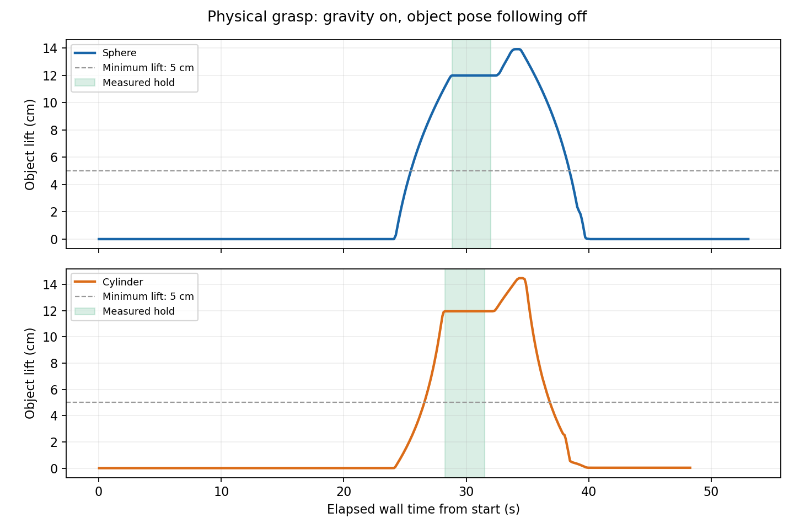

# 第三步：独立物理抓取开发与验收

[English report](stage3_physical_grasp_report.en.md) · [中文安装与复现指南](simulation/README.zh-CN.md) · [English reproduction guide](simulation/README.en.md)

日期：2026-10-13。范围：`simulation/`。承接随机视觉取放阶段（[完整复现指南](simulation/README.zh-CN.md)说明历史流程与当前物理模式），对应原规划中“把跟随演示变成物理抓取试验”的任务。

## 1. 本轮要解决什么

上一阶段证明了相机搜索、定位、规划、搬运和回零的流程。物品关闭重力，位置由跟随程序直接设置，因此尚未证明夹爪能够真正夹住物品。

本轮建立独立 `physics_grasp` 模式：物品启用重力、接触和摩擦，移除物品位姿插件，跟随节点禁止启动跟随。物品只能通过夹爪接触被带起，松开后受重力作用落下。

**本轮验收对象是两种已知几何物品的物理仿真抓取。** 机械臂采用位置 PID 施力控制和理想重力补偿，夹爪使用简化指垫碰撞体。它不是实机验收，也不是精确复现真实电机、夹爪材料或力控能力。

## 2. 已实现的改动

| 原问题 | 本轮处理 |
| --- | --- |
| 物品受位姿插件和跟随程序驱动 | 物理模式不加载物品位姿插件，跟随服务拒绝开启；模式开关必须明确选择流程或物理模式 |
| 几何距离被当成接触 | 为两侧指垫增加 Gazebo 接触传感器，区分是否接触当前目标；双侧接触缺失时拒绝抬升 |
| 直接设关节位置影响摩擦运动 | 物理模式中八个关节使用 Gazebo 位置 PID 施力，保留原轨迹控制接口；流程模式保持原位置接口 |
| 两指镜像存在时序差 | 物理模式关闭旧镜像节点，执行器向两侧控制器发送相同起始时间和持续时间的轨迹，并检查实际反馈 |
| 闭合仍留有开口余量 | 根据已知样品直径设定闭合预压，由位置 PID 对接触产生作用；不宣称真实夹持力闭环 |
| 可见表面点偏离几何中心 | 从红色区域 RGB-D 点估计球心、圆柱侧面轴心或完整顶面圆心；不将场景真值 XY 回填为抓取目标 |
| 图像时刻 TF 尚未到达 | 最多缓存六组图像，等待对应时刻 TF，超过 0.3 秒丢弃；不回退到任意最新 TF |
| 下降路径可能发生腕部绕转 | 候选路径及其 ±0.001 rad 起点邻域检查关节总跨度和耗时；执行下降前从新鲜实测状态重算 |
| 执行结束不代表准确落点 | 闭合前用实测关节 FK 检查目标点和姿态，最多一次有限纠偏，不满足条件则拒绝闭合 |
| 动作结束但物品没有被带起 | 使用 Gazebo 实际物品高度、双侧接触及反馈新鲜度确认保持，搬运和下降期间持续检查 |
| 放置时对桌面施压、残留单侧接触 | 在预定放置高度上方保留 25 mm 间隙后打开，退离夹爪，再确认接触消失及物品落稳 |
| 缺少独立物理试验数据 | 保存拟合中心、实际物品轨迹、接触力、状态、仿真时钟、拒绝记录和源代码版本；新增 CSV 导出 |

抓住后仍会在 **MoveIt 规划场景**中附着碰撞物体，使规划器考虑持物体积。这不会给 Gazebo 物品添加约束或驱动力。释放后恢复实际落点附近的世界碰撞物体。

### 2.1 初学者如何理解算法

1. **RGB-D 几何拟合：** 红色像素限定物品区域，深度和内参把像素变为空间点，再按图像时刻的 TF 转到世界坐标。球面使用已知半径拟合中心；竖直圆柱使用侧面圆或完整顶面圆拟合 XY，高度使用已知模型。
2. **KDL IK 与 OMPL：** 计算目标夹爪姿态的关节解，再规划避开碰撞的路径。短距离下降、抬升和退离使用笛卡尔路径。
3. **位置 PID：** 根据关节目标位置与实际位置的误差施力，让关节在动力学仿真中移动，使接触求解器能够计算运动速度及摩擦。它不同于根据实测夹持力调节目标力。
4. **接触与保持判断：** 两指接触是抬升的前提；物品确实升高并保持才证明拿起。仅看到 `HOLDING` 或 `COMPLETE` 状态不足以通过。
5. **有限状态机：** 搜索时由视觉控制器控制，抓取时交给执行器。忙碌时拒绝重复开始、修改放置区和复位；停止后必须显式复位。

本轮没有训练神经网络，也没有增加 YOLO、多目标选择或脑机解码。

### 2.2 模型和控制参数

| 项目 | 小球 | 实心圆柱体 |
| --- | --- | --- |
| 直径 | 35 mm | 50 mm |
| 高度 | 35 mm | 100 mm |
| 质量 | 15 g | 80 g |
| 闭合预压参数 | 单侧 2 mm | 单侧 4 mm |
| 物品摩擦参数 μ/μ2 | 1.2 / 1.2 | 1.2 / 1.2 |
| 物品接触 kp/kd | 100000 / 10 | 100000 / 10 |
| 线/角速度衰减参数 | 0.2 / 0.2 | 0.2 / 0.2 |
| 放置离桌间隙 | 25 mm | 25 mm |

圆柱体仍是实心近似模型，不能当成已验证的空心杯。物理模式采用 50 mm 直径，为原模型 70 mm 最大总开口留出余量；流程演示的 70 mm 圆柱体配置继续保留。没有扩大机器人关节行程。

物理指垫碰撞体为 20 × 62 × 8 mm 的长方体，位于原指尖网格的包络内。视觉和 MoveIt 继续使用原网格。抓取中心位于 `gripper_base` 沿工具轴 123.8 mm 处，较原 135.8 mm 指尖末端缩进 12 mm，让指垫覆盖物品中心附近。圆柱体在拟合几何中心上方 20 mm 的中上部夹持，降低腕部与物品的碰撞风险；球仍按球心生成目标。这些是仿真模型参数，未做实体 TCP 或指垫标定。

机械臂和夹爪连杆采用理想重力补偿；物品重力保持开启。关节位置 PID 的 P/D 为 J1 2000/30、J2 3000/40、J3 2000/25、J4 100/0.3、J5 300/1、J6 30/0.05、小球 J7/J8 300/0.2，圆柱体 J7/J8 600/1.0。参数用于当前模型，不应直接迁移到真实电机。

## 3. 开发中保留的失败

| 失败 | 观察及处理 |
| --- | --- |
| 初始局部夹爪 PID 导致关节漂移 | 在模型阶段退出或由 MoveIt 拒绝起点自碰撞；改为完整物理控制配置和理想机械臂重力补偿 |
| 两指接触后小球仍留在桌面 | 直接位置控制及异步镜像不足以稳定带起物品；改为施力 PID 和同步双侧轨迹 |
| 新双侧轨迹反馈等待失败 | 修正反馈字段为本机控制器使用的 `feedback`，等待期间释放互斥锁，允许回调更新 |
| 圆柱体没有有效中心输出 | 当前相机主要看到顶面；补充完整圆顶拟合，并等待图像时刻 TF |
| 圆柱体抬升或搬运后滑落 | 增加已知样品的闭合预压，并使用圆柱体专用夹爪位置 PID；保持判断继续按实际高度和接触进行，未放宽抬升条件 |
| 圆柱体放置后仍有单侧接触 | 留出释放间隙，退离后检查真正释放与落稳 |
| 圆柱体搬运中接触丢失 | 普通关节规划允许途中改变工具姿态；保持阶段通过后仍在搬运中失败，监督器停止；圆柱体改为约束工具姿态、平滑偏航的笛卡尔搬运 |
| 圆柱体搬运后下降路径不完整 | 下降仅完成 37.5% 时拒绝执行；增加中上部夹持偏移，并优先审查适合圆柱体的倾斜候选，保持碰撞检查 |
| 第一次预定随机批次第三轮小球被推离 | 同一种子前两轮通过，第三轮下降路径达 242 点后接触失败；保留整组数据，补充总跨度、耗时、起点邻域和实测下降检查后重新执行完整计划 |

第一次随机批次记录：`simulation/log/visual_sim/ball-20261013-214246-081409/`；源代码和控制台记录保存为 `validation/physics_grasp/attempt01_*`。前两轮通过和第三轮失败均保留，不混入修复后的最终统计。圆柱体首个随机批次的搬运失败保存在 `simulation/log/visual_sim/cylinder-20261013-221337-157785/`。随后仅修改非小球的物理搬运分支；小球已验收控制调用保持一致，并另做当前二进制回归。两个对象各自的源码/二进制版本和原始记录分别保留。小球 20 轮对应 `revision02`，圆柱体 20 轮对应后续最终版本；后续搬运姿态、中上部夹持及夹爪增益调整只用于圆柱体，最终小球物理模型与小球批次模型规范化比较完全一致。两批不能写成同一二进制的 40 轮试验；版本差异见[变更清单](../simulation/validation/physics_grasp/final_revision_changes.json)和[模型一致性校验](../simulation/validation/physics_grasp/final_model_integrity.json)。当前版本另做小球窗口取放回归，单列记录。

## 4. 验收协议与结果

### 4.1 预先规定的正向试验

计划在执行前保存于 `simulation/validation/physics_grasp/trial_plan.json`。小球与圆柱体各 20 轮，种子均为 20261013；起点范围 `x ∈ [0.38, 0.42] m`、`y ∈ [-0.12, -0.08] m`；A/B 区交替，各 10 轮。任一运动试验失败即停止整组，不自动重试失败抓取。只有运动前明确拒绝“无新鲜关节反馈”时保留拒绝记录并有界等待。

每轮必须满足：

1. 物品重力开启，位姿跟随关闭；抓取 XY 来自相机几何估计。
2. 闭合后确认目标双侧接触；实际抬升至少 5 cm。
3. 控制器按仿真时钟保持 3.3 秒，实际保持采样覆盖至少 3 秒，高度始终达到抬升条件。
4. 松爪、退离后接触消失；实际物品线速度低于 1 cm/s，落稳检查持续至少 0.5 秒。
5. 最终中心距离所选放置区小于 3 cm，六轴回零最大误差小于 0.02 rad。
6. 到达 `COMPLETE`，释放控制权，视觉回到 `IDLE`；执行器拥有控制权期间没有非零 Servo jog。

| 对象 | 完整取放通过 | 单轮耗时 | 实际抬升范围 | 最大放置误差 | 最小保持采样覆盖 |
| --- | --- | --- | --- | --- | --- |
| 小球 | 20 / 20 | 51.42–54.98 s | 13.32–14.84 cm | 0.70 mm | 3.00 s（仿真时钟） |
| 圆柱体 | 20 / 20 | 46.38–49.63 s | 14.21–14.48 cm | 20.68 mm | 3.00 s（仿真时钟） |

相机拟合中心与静态 Gazebo 中心的水平差异：小球均值/P95 为 0.54 / 0.56 mm；圆柱体为 0.49 / 0.60 mm。这是当前已知几何、理想相机和限定区域的仿真结果，不是实体手眼标定精度。

圆柱体第一轮运动前有一次“无新鲜关节反馈”拒绝，等待后在同一起点开始；记录保留，20 轮移动试验均一次通过。两组最大回零误差分别约 0.0000994 / 0.0001029 rad，控制权期间非零视觉 jog 均为 0。

可查看[每轮结果 CSV](../simulation/validation/physics_grasp/acceptance/trials.csv)、[统计 JSON](../simulation/validation/physics_grasp/acceptance/summary.json)、[预定计划](../simulation/validation/physics_grasp/trial_plan.json)和[批次核验](../simulation/validation/physics_grasp/batch_validation.json)。



图中各取一轮正向试验，纵轴为 Gazebo 物品中心相对初始高度，横轴为本轮经过的实际时间；绿色区域标出保持状态。保持门槛另按仿真时钟检查，不能由图的横轴代替。

构建与算法检查：仿真抓取包构建通过；45 个现有 GTest 用例和 4 个新增 Python 几何拟合用例通过。7 个 CTest 目标通过，colcon 汇总为 56 项，0 错误、0 失败、0 跳过。新增用例覆盖含深度噪声的局部球面、圆柱侧面、只有顶面的圆柱以及不足或不一致的深度输入。

最终仅从 `simulation/` 构建 `brain_robot_pick_place`、`brain_robot_ball_pick`、`piper_description` 三个受影响包；[构建日志](../simulation/validation/physics_grasp/build_final_revision.log)和[测试汇总](../simulation/validation/physics_grasp/unit_test_summary_final_revision.txt)保留。

### 4.2 失败处理试验

| 用例（各 1 轮小球物理仿真） | 实际观察 | 结果 |
| --- | --- | --- |
| 抓取位置沿 Y 偏离 60 mm | 可能发生单侧接触，但双侧接触缺失；拒绝抬升，物品最高增量约 0.000024 mm | `FAULT_GRASP_MISSED`，没有进入搬运 |
| 持物后主动打开夹爪 | 原始物品轨迹记录到至少 21.9 mm 的下降和接触丢失 | `FAULT_PHYSICAL_OBJECT_LOST_OR_FEEDBACK_STALE`，没有进入搬运；未将其描述为已经落回桌面 |
| 实际抬升中请求停止 | 物品已升高约 26.8 mm；停止后记录 1024 个关节样本，覆盖 2.046 s；留出 0.5 s 收敛后观察 1.546 s，最大推算速度约 0.0000024 rad/s | 视觉进入 `STOPPED`、控制权释放，没有继续搬运或报完成 |

三项均符合预期；[故障注入证据](../simulation/validation/physics_grasp/negative_checks.json)记录各自完整会话路径。停止取消轨迹后，执行器另报 `FAULT_PHYSICAL_LIFT_FAILED`，控制台仍进入受控停止；当前故障码没有进一步区分用户取消与抬升执行失败。三个批量程序按预期返回失败退出码，不计为正常取放成功。

故障注入只用于明确的单轮无窗口仿真；结果独立保存，不计入正向成功率。停止观察基于连续实测位置计算速度，不能用一条停止日志代替关节停止证据，也不据此声称已经达到实机急停延迟指标。

### 4.3 当前版本与流程模式回归

| 补充检查 | 结果 |
| --- | --- |
| 当前二进制，小球 Gazebo/RViz 窗口入口 | 1/1 物理取放通过；实际抬升 14.16 cm、保持采样 3.20 s 仿真时间、放置误差 0.39 mm、回零误差约 0.0000995 rad |
| 完成后 R 随机复位、Q 退出 | 生成第 2 个随机场景并确认就绪；父程序退出码 0，本程序拥有的进程组全部清理 |
| 原小球流程入口 | 1/1 通过；运动前 3 次“无新鲜关节反馈”拒绝独立保留，实际移动试验一次通过 |
| 原圆柱体流程入口 | 1/1 通过，无开始拒绝 |

这些是补充回归，单列在[回归检查记录](../simulation/validation/physics_grasp/supplemental_regression.json)，不增加两组预定 20 轮的统计分母。窗口测试核验入口启动、取放状态、实际观测、复位与退出，没有新增界面布局或实机视觉验收。部分 ROS/MoveIt 子进程响应关闭信号时仍输出历史清理异常；此处的退出码指父程序，进程组已回收，不表示每个组件都以 0 退出。

## 5. 一个终端如何操作

小球：

```bash
cd ~/brain-robot-arm/simulation
./scripts/run_ball_physics_sim.sh
```

圆柱体：

```bash
cd ~/brain-robot-arm/simulation
./scripts/run_cylinder_physics_sim.sh
```

等待“就绪”，在启动终端按 1/2 选择 A/B 区，S 开始，完成后 R 随机复位，X 停止，Q 或 Ctrl+C 退出；按键无需回车。两个入口共用实例锁，一次只能运行一个。

该入口会自动加载物理模型、Gazebo、MoveIt、腕部相机、检测和中心估计；默认等待 S。只加载仿真工作区，不加载真实驱动。关闭后只回收本程序创建的进程组。

原 `run_ball_visual_sim.sh` 和 `run_cylinder_visual_sim.sh` 继续提供跟随式流程演示，两种模式的数据分别统计。

### 5.1 无窗口复现和导出

下面会自动执行虚拟机械臂动作，两个命令依次运行：

```bash
./scripts/run_ball_physics_sim.sh --headless --seed 20261013 --batch-trials 20
./scripts/run_cylinder_physics_sim.sh --headless --seed 20261013 --batch-trials 20
```

日志位于 `simulation/log/visual_sim/<物品-时间>/`。`scene-NNN.yaml` 保存随机起点与物理参数，`physics-*-task.yaml` 保存抓取配置，`session.json` 保存每轮物品轨迹、接触、仿真时钟和结果，`events.jsonl` 保存状态和拒绝请求；其余文件保留各组件原日志及锁定附近的 RGB 图像。

导出当前物理会话，输出目录必须不存在：

```bash
python3 -s scripts/analyze_physics_grasp.py \
  log/visual_sim/实际小球会话目录 log/visual_sim/实际圆柱体会话目录 \
  --output validation/physics_grasp/新的统计目录
```

### 5.2 主要源码入口

| 文件 | 阅读目的 |
| --- | --- |
| `scripts/visual_sim_console.py` | 模式配置、按键、随机起点、观测与有界验收 |
| `src/brain_robot_pick_place/scripts/physics_target_node.py` | 从相机 RGB-D 拟合已知几何中心 |
| `src/brain_robot_pick_place/src/grasp_lift_executor.cpp` | 控制权、候选筛选、同步夹爪、接触、保持、释放与回零 |
| `src/brain_robot_pick_place/urdf/piper_with_wrist_camera_gazebo.xacro` | 腕部相机与指垫接触传感器 |
| `src/piper_description/urdf/piper_description_gazebo.xacro` | 独立物理模型、指垫和位置 PID 参数 |
| `src/brain_robot_ball_pick/scripts/ball_scene_manager_node.py` / `src/brain_robot_pick_place/scripts/scene_manager_node.py` | 物品重力、摩擦和位姿插件的模式选择 |
| `scripts/analyze_physics_grasp.py` | 物理试验 CSV 与指标汇总 |

## 6. 证据与限制

最终会话：小球 `simulation/log/visual_sim/ball-20261013-215208-707208/`，圆柱体 `simulation/log/visual_sim/cylinder-20261013-225235-997677/`。汇总、CSV、计划、原始版本快照、构建/测试日志与真机工作区校验位于 `simulation/validation/physics_grasp/`。原始导入来源清单不改写，后续源码变化单独保存。

小球批次源码归档为 `revision02_accepted_source.tar.gz`，其二进制哈希在 `revision02_acceptance_source_hashes.json`；圆柱体及最终回归源码归档为 `accepted_source.tar.gz`，二进制哈希在 `acceptance_source_hashes.json`。运行后再次检查 81 个源码/二进制文件，均与最终验收哈希一致；24 个 Python 文件语法解析和本地文档链接检查通过，见[静态校验](../simulation/validation/physics_grasp/final_static_checks.json)。

原始会话随 `simulation/validation/physics_grasp/raw_sessions.tar.gz` 上传，解压后保留上述 `log/visual_sim/` 相对路径。源码归档和历史哈希保留各自版本，不将它们当作所有当前发布文件的校验和；发布增加环境自检与独立构建脚本，并单列干净目录的重新构建与运行检查。

本轮没有安装依赖、修改系统配置、构建真实工作区或操作硬件；334 个真实工作区导入文件哈希仍与导入清单一致。

当前限制：

- 使用已知半径、竖直圆柱高度、固定桌面及理想相机 TF；未实现未知几何、未知桌面或任意六自由度姿态估计。
- 指垫和摩擦均为简化仿真参数，机械臂采用理想重力补偿；不据此声称真实材料、真实电机和力传感器已经标定。
- 圆柱体最大放置误差约 2.07 cm，虽满足本轮 3 cm 门槛，仍需改进搬运姿态、释放和接触参数。
- 放置从预定 25 mm 间隙释放，只用于当前非易碎仿真样品；尚未建立易碎物品的柔顺落放策略。
- 随机验证只覆盖 4 cm × 4 cm 区域和两个单物品场景；不是整张桌面、10 类物品或双场景的成功率。
- Gazebo 接触力是仿真求解结果，不能直接作为实际夹持力标定或申请书力度指标。

实现参考：[Gazebo ROS 接触插件](https://github.com/ros-simulation/gazebo_ros_pkgs/blob/ros2/gazebo_plugins/src/gazebo_ros_bumper.cpp)、[Humble Gazebo 位置 PID 接口](https://control.ros.org/humble/doc/gazebo_ros2_control/doc/index.html)。本机行为仍以保存的模型、实际运行及测量为准。

## 7. 下一阶段

先保留双物品物理回归并改善圆柱体落放误差，再按整体规划进入多类别视觉和规则抓取：先选定 3 类真实样品与尺寸范围，建立独立训练/测试数据，接入 YOLO 检测和可靠深度区域；明确目标 ID 和选择接口，再逐类增加几何规则及候选评分。

保留本轮物理回归集，比较几何规则、视觉修正和不同接触参数的效果。随后再接入模拟头部姿态与抓取/停止语义指令，单独开展真机设备核实、手眼标定和监督测试。BC/DDPG 仍放在可靠规则基线及有效反馈之后。

## 8. GitHub 发布复现检查（2026-10-14）

发布前从新的仓库目录重新构建全部七个包，未使用原工作区的 build/install。49 个算法用例通过（含 CTest 汇总为 56），新目录小球/圆柱体各一轮物理取放和小球窗口取放、R 随机复位、Q 退出通过。补充回归独立统计，不增加历史 20+20 轮分母。新增环境自检、独立构建脚本、明确 Fast DDS 和依赖声明修复；运行命令与证据见[双语发布核验](simulation/PUBLISH_VALIDATION.md)、[中文指南](simulation/README.zh-CN.md)和[英文指南](simulation/README.en.md)。
