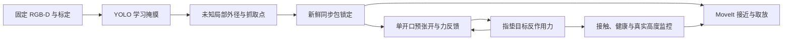
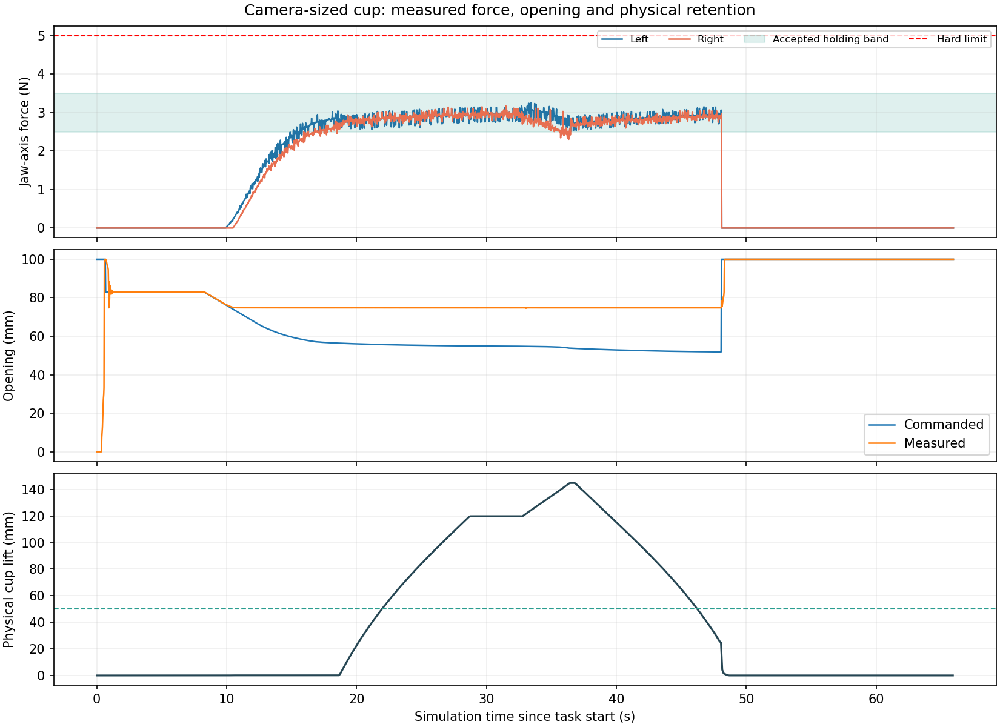
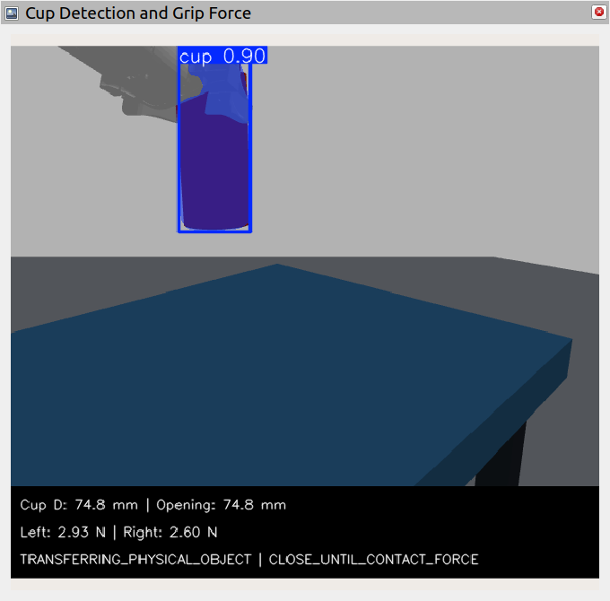
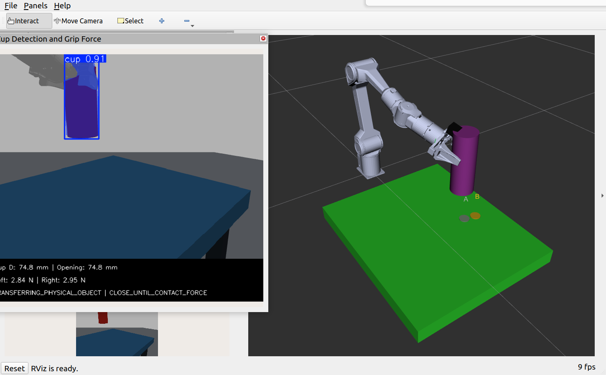

# 第五步：水杯视觉估径与力反馈抓取开发与验收

日期：2026-10-14。范围：`simulation/`；GitHub 独立发布目录 `simulation_cup_grasp/`。承接[第四步](第四步_水杯训练与自适应夹持基础验证.md)。最终固定批次和窗口验收已完成；发布核验和归档回执随发布记录补齐。

## 1. 本轮目标

将第四步的学习掩膜、RGB-D 外径估计和离线夹持策略接到真实动力学仿真流程：相机估径 → 保守预张开 → 实测力闭合/保持 → 实际抬升与搬运 → 松爪落稳 → 回零。权重、训练集和两轮训练记录不改变，不重新训练 YOLO。

本轮是无把手、不透明空杯的仿真验收。杯身外径75 mm、高160 mm；杯口外径63 mm、高40 mm，近似台阶连接；质量80 g、壁厚2 mm为假设。机器人总开口100 mm与用户指定大夹爪相符；动力学、摩擦、塑料强度、实体TCP与力传感器没有原厂实测标定。

## 2. 已实现的流程与职责



- `yolo_cup_target_node.py` 只发布视觉结果，不控制机器人、不读物品真值；按图像时刻标定把配准深度转到世界点云，拟合抓取高度处的未知局部圆直径。
- 执行器要求抓取点/宽度包具有相同非零时间戳、世界坐标、有效标志和足够新鲜的图像；按 `外径 + 2σ + 6 mm` 预张开，超过100 mm或不确定度过大时拒绝，不把超尺寸夹紧到上限。
- 预张开服务握手后等待新的锁定包，避免传输延迟使早先有效的视觉包过期；实际开口反馈完成后才接近，实际FK落点合格后才闭合。
- `cup_force_gripper_node.py` 是两侧轨迹的唯一发布者；命令严格为 `joint7=opening/2`、`joint8=-opening/2`。原厂SDK只有一个开口量，已移除开发版的独立指尖中心平移。
- 位姿PID通过接触预压产生力；连续轨迹显式从上一命令端点接续，防止反复从受阻实际位置插值而丢失预压。命令开口小于实际开口不代表刚性杯被压缩。
- 两侧力连续合格至少0.5仿真秒后进入保持；力闭环继续调节。抬升、保持、搬运和放置下降期间持续验证双侧接触、健康、数据新鲜度与物品真实高度。
- Gazebo没有物品跟随或吸附驱动。MoveIt中的附着物只用于持物碰撞规划；实际搬运由接触、摩擦和重力决定，松爪后验证落稳、脱离指垫并回零。

碰撞场景仍由仿真生成的物品几何构建。目标XY与局部直径不读取Gazebo真值；真实位姿参与独立验收。尚未实现从未知真实场景点云自动重建所有碰撞物。

## 3. 控制、时序与模型约束

| 项目 | 当前配置 |
| --- | --- |
| 总行程 / 单侧边界 | 100 mm / 50 mm |
| σ下限 / 最大接受σ | 1 mm / 4 mm |
| 图像包最大年龄 | 0.5 s |
| 力反馈最大年龄 | 0.2 s（接收时钟） |
| 双侧目标范围 / 区间中点 | 每侧2.5–3.5 N / 3 N |
| 观察到的过载阈值 | 每侧5 N |
| 最大闭合策略步速 | 4 mm/s，仿真时间有界积分 |
| 指垫PID P/D | 300 / 0.5，仿真调试值 |
| 抓取高度 | 观测杯高的60%；第四步只读回放默认55%仍保留 |
| 倾斜候选 / 虚拟抓取参考偏移 | 1.2、1.0、0.70 rad / 130 mm |
| 物品抬升 / 保持 / 放置间隙 | 120 mm / 3.3仿真秒 / 25 mm |
| Gazebo时钟 / 关节TF / RViz | 100 Hz / 50 Hz / 10 fps |
| 接触轴变换时效 | 原150 ms边界，优先接触时刻TF |
| ROS域 / Gazebo端口 | 本地85 / 11485 |

杯身/杯口仍中空，由48面凸碰撞楔近似；底部换成一个薄圆盘，避免48个共面底面接触，总计145个碰撞体。ODE迭代200，摩擦μ/μ2=1.2，接触kp/kd=100000/10。模型不模拟塑料变形与压坏；机器人使用理想重力补偿。这些不是原厂额定性能。

### 3.1 正确解释接触力

Gazebo传感器消息会缓冲多个物理步。控制只选最新物理步，先合成目标杯作用于整块指垫的反作用力，再投影到实测闭合轴。各点绝对法向载荷之和独立保存作诊断；不跨时间叠加，也不重复加total_wrench。过载阈值作用于已观察到的反馈样本，不宣称捕获采样间所有峰值或标定真实塑料强度。

第四步历史34.44/25.49 N包含跨物理步及各点载荷累加，不能解释为瞬时净夹持力；已在中英文第四步报告更正解释，原始日志保留。SDK effort/torque为扭矩，不能直接当作本轮N。[SDK反馈定义](https://github.com/agilexrobotics/piper_sdk/blob/c9e8a28174e71eeaac448593cb65f8ab258a92fe/piper_sdk/piper_msgs/msg_v2/feedback/arm_feedback_gripper.py)

## 4. 重要失败及修正

| 观察 | 修正与保留证据 |
| --- | --- |
| 服务出现时MoveIt尚未准备好 | 等待接口真正准备；周期就绪通知避免重建后一次消息丢失 |
| 锁定包到夹爪时超时 | 服务握手后获取新包，保持原新鲜度门限 |
| 多物理步及边缘载荷被累加 | 分离最新步净轴力与gross诊断，保留原始接触消息 |
| 连续单点轨迹丢失夹持预压 | 双点轨迹从上一命令接续，保存命令/实际开口曲线 |
| 靠近腕部的放置下降被碰撞规划拒绝 | 使用合法、较外侧A/B区域，保留碰撞检查 |
| 复合模型热删除导致Gazebo堆错误 | R完整重建拥有的仿真栈；失败动作不自动重试 |
| 回零后存档耗时使终端反馈暂时过期 | R先等待新鲜回零反馈，不以旧反馈直接复位 |
| 过载测试脉冲在回调前过期 | 测试信号锁存直至控制周期消费一次；注入明确标记，不冒充物理过载 |
| 图形负载下指垫TF超过150 ms | 时钟100 Hz、关节TF50 Hz、接触时刻查询，保持原时效边界 |

暂停前15轮和恢复后的开发轮次、r1–r7、图形失败全部留存。历史通过轮次不添加到最终固定批次分母。首次有效GUI取放后复位通知丢失，也保留为发现生命周期问题的证据。

## 5. 最终验收数据

最终冻结版本r8完整执行：75 mm **5/5**，55 mm **2/2**，85 mm **2/2**；5种负测均通过（偏位没有双侧夹持就不抬升、抬升中反馈丢失、合成6 N过载、中途停止、105 mm超开口视觉拒绝）。所有组源码哈希未变。前序r6/r7对照通过与失败单独保留，本表只统计最终r8。

| 指标 | 最终9次取放 |
| --- | --- |
| 最大三维放置误差 | 0.916 mm |
| 最短实测保持跨度 | 3.16仿真秒 |
| 最小峰值实际抬升 | 144.79 mm |
| 最大回零关节误差 | 0.0000977 rad |
| 最大最终杯轴倾斜 | 0.0011495 rad |
| 保持阶段全部双侧力样本范围 | 2.659–3.221 N |

最终GUI：S完整取放通过，R重建重新就绪，B区选择、X在放置下降中停止、Q清理均验证；GUI成功轮次独立统计，放置误差约0.731 mm，保持时轴TF最大延迟21 ms。抬升中停止由固定负测另验。核心91项汇总检查通过；独立发布目录从空build/install构建七包成功，核心91项通过。发布物理试验和归档恢复/远端核验见相应回执。

曾扩展检查全工作区：当时187项汇总、74失败，均来自未改上游版权/格式；13个相关Python/CMake文件与第四步Git blob一致。新增用例后核心变为91项，此处没有把全工作区lint标成通过。保留完整失败输出和对比证据。

原始固定结果：`simulation/validation/cup_grasp/acceptance_r8_final/results.json`、`final_acceptance.json`、各会话`session.json`。判据为实际抬升≥50 mm、保持≥3仿真秒、每个保持力样本双侧2.5–3.5 N且新鲜健康、放置误差<30 mm、回零<0.02 rad、倾斜<0.12 rad、物理释放及无非零Servo指令。

## 6. 本机与GitHub复现操作

已有当前环境的本机：

```bash
cd /home/young1x/robot_projects/piper_robot/simulation
bash scripts/run_cup_grasp_sim.sh --seed 20261015
```

首次构建：

```bash
cd /home/young1x/robot_projects/piper_robot/simulation
bash scripts/build_simulation.sh
bash scripts/setup_cup_vision_env.sh
bash scripts/run_cup_grasp_sim.sh --seed 20261015
```

等待五步加载和`[就绪]`，在启动终端按`1`→确认放置区→`S`；完成后`R`重建，等待再次就绪，按`2`→确认→`S`。`X`停止，`Q`退出，不用回车。Gazebo和RViz展示机械臂/杯子；独立的“Cup Detection and Grip Force”窗口显示大图、实际开口和双侧力，可拖动位置。

GitHub用户先克隆或pull，再进入`brain-robot-arm/simulation_cup_grasp`，运行同样三个脚本。完整依赖、检查、各直径与负测命令见[中文复现指南](cup_grasp/README.zh-CN.md) / [English guide](cup_grasp/README.en.md)。只读五视角回放与球/圆柱旧入口继续保留，不与水杯模式混合统计。

```bash
python3 scripts/verify_cup_grasp_suite.py --case all
```

## 7. 数据与复原

每轮存档RGB-D/掩膜/标定和锁定时刻、目标估计、物品/关节轨迹、两侧力、实际与命令开口、状态、场景/任务参数、日志、源代码快照与SHA-256。数据在`simulation/log/visual_sim/cup-时间/`；汇总和构建/测试在`simulation/validation/cup_grasp/`。

发布的分段归档与校验清单位于新工作区的`validation/cup_grasp/archives/`。恢复到一个不存在的新目录：

```bash
python3 scripts/restore_cup_grasp_archives.py --destination recovered_cup_grasp
```

历史world/SDF中的本机绝对路径只作为证据，不直接用来启动新机器；入口会重新生成本机路径。RGB-D/掩膜/标定数据自包含，源码哈希用于核查版本。第四步完整训练档案继续保留在旧`simulation_cup/`。







## 8. 当前边界与下一阶段

实现了仿真视觉估径与反馈抓取结合，没有完成实机、透明/带把手/装水杯、多目标选择、运动目标追踪、未知场景碰撞重建、材料强度判断或脑机解码。固定相机/桌面与单直立杯、假设质量/摩擦、简化指垫和理想重力补偿都是当前前提。

下一阶段依次确认实机夹爪/固件和反馈接口，采集真实杯子图像与测量值，完成RGB-D和机械臂/TCP标定及离线回放，核查扭矩/电流到夹持力的适用换算，再在监督下做低速单杯验证。硬件动作需要另行明确授权与现场监督；本轮未连接或控制实机。


### 独立发布目录与旧入口回归

- 独立发布目录七包从空build/install构建约1分38秒；最终就绪心跳修订后的增量核验构建约1分47秒。91项核心检查通过，212个源码/配置/模型文件与本机一致。视觉依赖复用本机已安装的固定私有环境，未重新安装系统包；不把此验证称为全新操作系统安装测试。
- ball 1/1，放置误差 0.607 mm；该补充试验独立统计。
- cylinder 1/1，放置误差 16.004 mm；该补充试验独立统计。
- published-cup 1/1，放置误差 0.840 mm；该补充试验独立统计。


### 全数据归档校验

全部18177个阶段文件已归档为两个最大45 MiB分段，合并归档55239926 bytes；恢复到新目录后每个文件SHA-256与原清单一致。训练数据/旧模型仍在第四步旧目录保留。恢复验证回执：`validation/cup_grasp/archive_restore_verification.log`。


### GitHub发布核验

已以YouNg1x上传；代码提交[`c3bd3fd`](https://github.com/bcwsyn/brain-robot-arm/commit/c3bd3fd319ecaa461ff373f093d979897aa3cf44)，标签`cup-grasp-force-v1-20261014`。基于远端并发更新027359e合入，原brain_robot_arm/、simulation/、simulation_cup/完整Git树保持与该最新基线一致。远端main/tag与代码提交匹配，重新下载模型SHA-256一致。回执在新工作区`validation/cup_grasp/github_publication.json`；后续小提交只保存发布回执。
