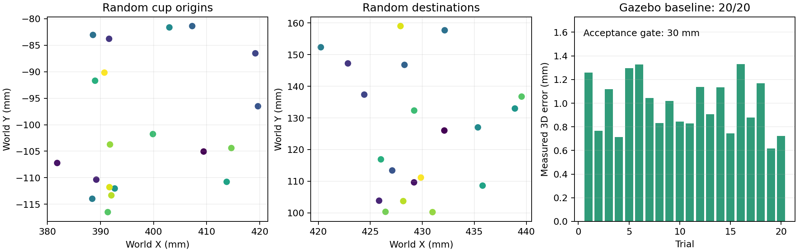
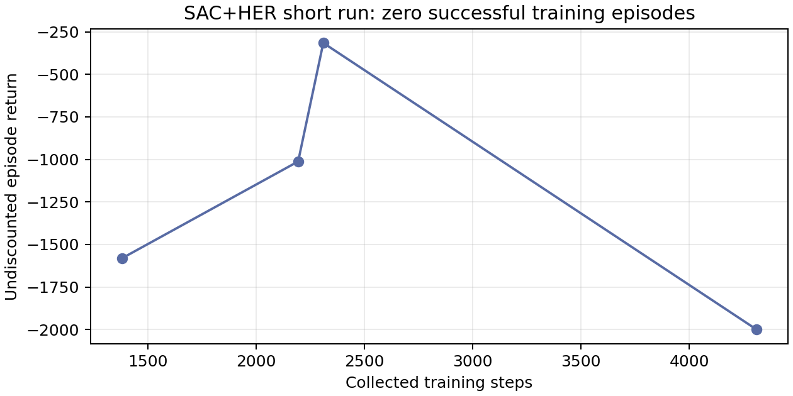
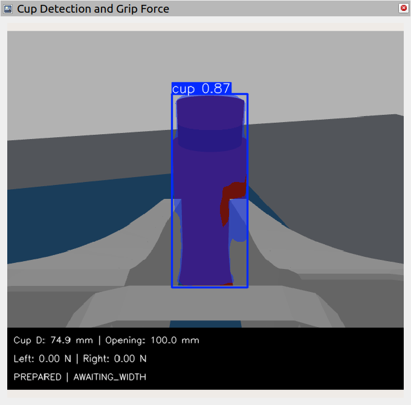
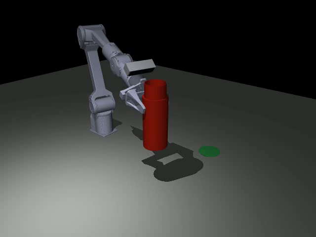

# 第六步：随机起终点抓放基准与强化学习环境验收

日期：2026-10-15。范围：独立 `simulation/`；GitHub 发布目录 `simulation_cup_random_rl/`。承接[第五步倾角报告](第五步补充_腕部相机倾角修正与验证.md)。本阶段目标是随机取放基准及可复现的强化学习环境/训练入口，尚未完成可用强化学习策略的收敛验收。

**本阶段随机抓放基准、强化学习环境、训练/恢复入口和独立发布复现已完成。强化学习策略独立评价0/20，尚未收敛。**

## 1. 需求与实现范围

保留用户确认的无把手、不透明空杯：杯身75×160 mm、杯口外径63×40 mm、总高200 mm。夹爪最大行程100 mm；腕部Gemini2安装倾角19.81°、名义光轴位置及105 mm轴向指尖间距不变。80 g质量、2 mm壁厚仍为假设。

把随机起点解释为杯子的初始桌面位置，新增随机终点和指定世界坐标终点；尚不随机化机械臂起始关节姿态。所有Gazebo视觉仍来自同一腕部RGB-D相机；YOLO权重没有重新训练或替换。

新终点采样区域为X420–440 mm、Y100–160 mm；原起点区域X380–420 mm、Y−120至−80 mm保留。只适用于同一水平桌面的小范围任务，不外推为任意工作空间或任意6D放置。

## 2. Gazebo基准修改

- 共享种子采样器在启动运动前保存起终点计划；支持 `--random-goal` 和 `--goal-xy X Y`，默认A/B模式继续可用。
- 初始位置由YOLO掩膜、注册深度、相机内参和图像时刻TF估计。Gazebo物品真值用于已知碰撞模型、物理监测和独立验收，不替代视觉抓取目标。
- 随机起点暴露同一杯子的两个重叠分割结果；新增掩膜IoU≥0.75且拟合三维中心、直径与高度均在2 mm以内的一致性判断，合并重复实例。独立多杯仍拒绝，不能按最高置信度任意选择。
- 按仿真重建代次保存锁定/拒绝RGB-D帧，避免仿真时钟重置后同名证据冲突；失败保留，不自动重试运动。
- 首个20轮计划在第7轮遇到MoveIt场景响应丢失：6轮成功，7轮尝试，13轮未执行。将初始场景读取改为持久客户端、每次2秒有界等待及场景等待期内的只读重查；不延长任务超时或放宽力/定位验收。

开发失败会话、4轮开发成功与重新冻结的正式批次分别统计。

## 3. 强化学习环境

保留Gazebo为现有视觉/力反馈验收环境；另建MuJoCo物理训练环境，避免为每个训练动作重新启动ROS/Gazebo。MJCF由当前Gazebo URDF生成，未使用旧MJCF或 `mujoco_py` 控制器。核对关节范围、运动学、当前质量/惯量、100 mm夹爪和腕部相机姿态，15组随机关节配置的逐链接FK与URDF一致。

MuJoCo杯子是中空台阶壳体近似，理想机械臂重力补偿保留，杯子受独立重力、接触和摩擦；只有reset初始化位姿，step不附着或移动物品真值。接触参数和控制器尚未做Gazebo等价或实机动力学标定。

| 项目 | 本阶段实现 |
| --- | --- |
| 输入 | 33维状态、7维achieved_goal、7维desired_goal；含杯子仿真真值，无图像输入 |
| 动作 | XYZ每步最大±4 mm和夹爪请求，共4维 |
| 姿态先验 | 固定1.2 rad工具倾角、径向yaw，非任意6D控制 |
| 物理步进 | 每动作20×2 ms，25 Hz |
| 运动限制 | 关节目标变化整体比例限速0.3 rad/s，夹爪100 mm；力目标2.5–3.5 N、硬限5 N |
| reset | 随机杯子/终点，通过IK初始化该杯的预抓取位，未训练固定观察位搜索过程 |
| 成功 | 双侧接触下抬升≥50 mm；目标15 mm内直立松爪，低速、无指垫接触并连续稳定10步 |
| 终止 | 碰撞、过力、倾倒/跌落；2000步上限 |
| 随机化 | 可选质量/摩擦±20%；尺寸当前固定 |

## 4. 已完成的独立验证

ROS核心88项用例通过，11个CTest组全部通过；独立RL19项检查通过。检查包含模型FK/关节范围、种子重置、非法目标/动作、真正物理步进、HER批量奖励、超时、过力卸载及动力学随机化。

脚本控制器在冻结MuJoCo环境完成3/3物理取放，种子100/101/102，误差0.666/0.548/0.533 mm，峰值双侧力均低于5 N。零动作200步测速约500步/墙钟秒，结果受机器负载影响；此测速不包含神经网络优化与完整动态抓放。

**上述3/3是脚本控制器的环境可解性验证，不是强化学习成绩。**

冻结SAC+HER短训练：种子20261015，5000步、2800次优化更新，保存模型、完整经验缓冲、源码与配置。训练成功0轮；独立种子2026101600–2026101619评价 **0/20**，全部2000步超时。短训练确认管线可训练，未学会完整抓放，不能部署为可用策略。

恢复同一模型和经验缓冲后追加3000步，累计8000步、5800次更新，验证恢复入口可执行；该恢复试验单独保存，没有计入5000步冻结策略的评价。

正式冻结批次 `cup-20261015-010128-299621`，种子2026101510，20个不同起点与20个不同终点 **20/20** 完成物理取放；与此前6/7失败批次及4轮开发成功分别统计。所有运动源码哈希与当前版本一致。

| 正式Gazebo指标 | 结果 |
| --- | --- |
| 最大三维放置误差 | 1.331 mm（预设验收门限30 mm） |
| 最小实际抬升 | 144.794 mm |
| 最短保持 | 3.150仿真秒 |
| 保持双侧力范围 | 2.656–3.201 N |
| 最大最终倾角 | 0.000527 rad |
| 最大回零关节误差 | 0.000099 rad |

独立发布目录从空build/install构建7个包，88项核心用例/11测试组通过，19项RL检查通过；重新由发布URDF生成的MJCF与本机XML一致。图形指定终点 `(0.43,0.14)` m 取放1/1，误差0.900 mm、保持3.23仿真秒；R重建到新的观察/识别就绪状态，Q正常退出。该图形结果单独统计。





稀疏完整取放任务中，5000步只有4个完整训练回合；没有从真实图片学习，也未证明增加步数即可收敛。正常步−1、落稳0、故障−200；HER保留目标无关的故障信息，且最后落稳一步发生故障也不能记成功。完整成功示范转移另存于 `final_environment/scripted_transitions.npz`，供下一阶段探索/模仿初始化使用。

## 5. 可视化与复现操作

完整环境与命令：[中文指南](random_cup_rl/README.zh-CN.md) / [English guide](random_cup_rl/README.en.md)。本机从 `simulation/` 执行：

```bash
bash scripts/run_cup_grasp_sim.sh --seed 2026101510 --random-goal
```

等待就绪后S执行，R生成下一轮，Q退出。指定目标点：

```bash
bash scripts/run_cup_grasp_sim.sh --seed 2026101510 --goal-xy 0.43 0.14
```

独立训练与评价：

```bash
bash scripts/setup_cup_rl_env.sh
bash scripts/run_cup_rl.sh --steps 5000 --seed 20261015 --output artifacts/cup_rl/my_smoke
.venv-rl/bin/python -s scripts/evaluate_cup_rl.py --run artifacts/cup_rl/my_smoke \
  --episodes 20 --seed 2026101600 --output validation/my_policy_evaluation
```

阶段记录回放：

```bash
.venv-rl/bin/python -s scripts/replay_cup_rl.py validation/stage6_random_rl/final_environment --episode 1
.venv-rl/bin/python -s scripts/replay_cup_rl.py validation/stage6_random_rl/final_policy_evaluation --episode 1
```

前一条是脚本控制器成功回放，后一条是学习策略失败回放；回放不是新物理验收。第三人称窗口只是调试观察，不是视觉输入。已保存第三人称和腕部视角视频。





RViz绿色杯子仍是保守规划碰撞圆柱；实际Gazebo外观和MuJoCo壳体是台阶杯，不能将规划近似等同于真实碰撞细节。

## 6. 数据、版本与已知限制

保留全部失败会话、开发会话、正式批次、训练原型、冻结权重与经验缓冲、恢复试验、独立评价和回放；按逐文件SHA-256归档并在新目录恢复核验。归档共10880个文件，合并275531560 bytes，6个最大45 MiB分段；仅使用分段恢复后，全部文件SHA-256逐一匹配。整档SHA-256：`a55848eceaa960ba450ee6881d2de09cfdd12387e3f91c2f2c173c8cc18820f3`。原始大归档在本机保留，GitHub上传6个分段、清单和校验文件。 发布版本回执单独记录。

当前强化学习使用理想三维状态并从预抓取位开始；尚未接入腕部视觉估计、遮挡/深度缺失状态更新和实机反馈。原腕部相机遮挡仍存在，重复实例合并没有解决复杂真实环境识别问题。没有使用真实图片，没有连接实机；真实工作区不修改。

## 7. 下一阶段

先用脚本成功轨迹和分阶段任务帮助稀疏奖励探索，建立可见的学习曲线，使用多个训练种子和冻结的独立起终点集评估；比较SAC+HER与传统基准的成功率、误差、耗时和故障率。策略达标后，再将杯子真值替换为腕部RGB-D估计，加入遮挡、深度误差与延迟，逐步扩大可达取放区域。真实图片可以用于后续视觉验证，但不是本阶段仿真训练的前置条件。

## 8. GitHub发布回执

原仓库已更新，新独立目录 `simulation_cup_random_rl/`；代码提交 `5c0260f8dceb9dc8639b43d9ba3774da7ed77fb6`，标签 `cup-random-rl-env-v1-20261015`，作者YouNg1x。旧五个工作区Git树完全相同，远端并行标定历史保留。远端控制入口、环境源码与英文指南重新下载逐字节哈希匹配。训练模型仍为0/20，发布不代表模型已经收敛。
